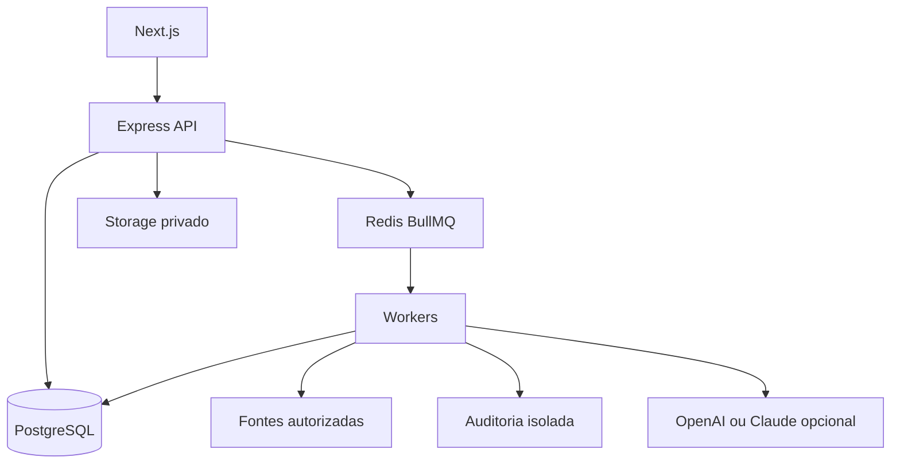

# Arquitetura
Monólito modular TypeScript com Next.js (React), Express, Prisma/PostgreSQL Supabase, PostGIS, Supabase Auth/Storage, Redis/BullMQ e workers Playwright/Lighthouse isolados. Zod nos limites. MapLibre, Tailwind, shadcn/ui, Phosphor, Recharts e dnd-kit na interface.

## Estrutura alvo
`apps/web`, `apps/api`, `apps/worker`, `packages/domain`, `packages/contracts`, `packages/db`, `packages/providers`, `packages/ui`. Domínio sem dependência de HTTP ou SDK. Adaptadores implementam interfaces. Transações curtas; outbox transacional para eventos e reconciliação de jobs. Chave de idempotência por tenant/tipo/entrada; retries exponenciais com jitter e DLQ; cancelar jobs e controlar concorrência por tenant.
## ADRs
ADR-001 PostgreSQL em vez de MySQL: RLS/PostGIS. ADR-002 monólito antes de microsserviços: menor complexidade. ADR-003 IA opcional: previsibilidade e fallback. ADR-004 fontes independentes com política por campo. ADR-005 implementação original: não copiar código LOBAE sem autorização/licença. Todas propostas para ratificação. ADR-006 contexto de tenant via RLS com role sem bypass: aceito, ver [adr/ADR-006-tenant-context-rls.md](adr/ADR-006-tenant-context-rls.md).
## Implantação
Ambientes local/staging/produção separados, segredos no gerenciador, migração revisada, backups e restauração testada, CI com lint/typecheck/test/build, deploy com aprovação e rollback compatível.
